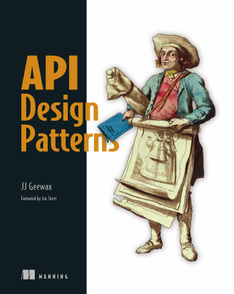

# API Design Patterns

[← API & Web Security](../README.md) · [All categories](../../../README.md#categories)

- **Author(s):** JJ Geewax
- **About:** Practical techniques for designing consistent, maintainable HTTP APIs.
- **Publisher / official book:** [Manning — buy print or ebook](https://www.manning.com/books/api-design-patterns)
- **Access:** [Google Books search](https://books.google.com/books?q=API%20Design%20Patterns)
