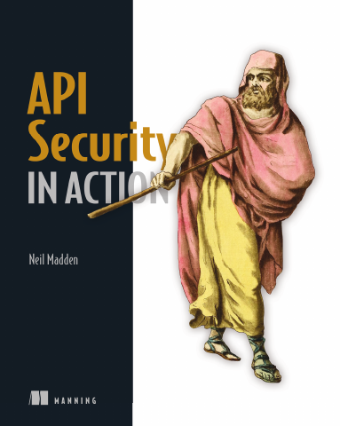

# API Security in Action

[← API & Web Security](../README.md) · [All categories](../../../README.md#categories)

- **Author(s):** Neil Madden
- **About:** Authentication, authorization, and defensive API engineering.
- **Publisher / official book:** [Manning — buy print or ebook](https://www.manning.com/books/api-security-in-action)
- **Access:** [Google Books search](https://books.google.com/books?q=API%20Security%20in%20Action)
