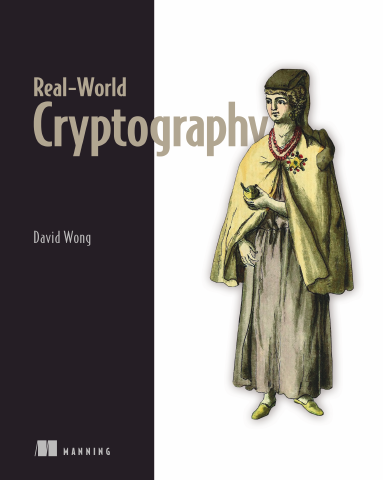

# Real-World Cryptography

[← API & Web Security](../README.md) · [All categories](../../../README.md#categories)

- **Author(s):** David Wong
- **About:** Cryptography principles and their use in real systems.
- **Publisher / official book:** [Manning — buy print or ebook](https://www.manning.com/books/real-world-cryptography)
- **Access:** [Google Books search](https://books.google.com/books?q=Real-World%20Cryptography)
