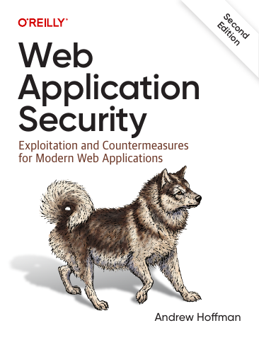

# Web Application Security, Second Edition

[← API & Web Security](../README.md) · [All categories](../../../README.md#categories)

- **Author(s):** Andrew Hoffman
- **About:** Common web vulnerabilities and defensive application practices.
- **Publisher / official book:** [O’Reilly — 2nd edition](https://www.oreilly.com/library/view/web-application-security/9781098143923/)
- **Access:** [Google Books search](https://books.google.com/books?q=Web%20Application%20Security)
