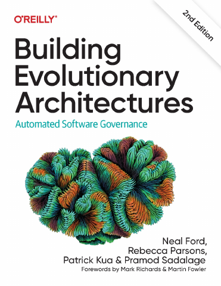

# Building Evolutionary Architectures, Second Edition

[← Architecture & Scalability](../README.md) · [All categories](../../../README.md#categories)

- **Author(s):** Neal Ford, Rebecca Parsons, Patrick Kua, and Pramod Sadalage
- **About:** Architectures that adapt safely through fitness functions and incremental change.
- **Publisher / official book:** [O’Reilly — 2nd edition](https://www.oreilly.com/library/view/building-evolutionary-architectures/9781492097532/)
- **Access:** [Google Books search](https://books.google.com/books?q=Building%20Evolutionary%20Architectures)
