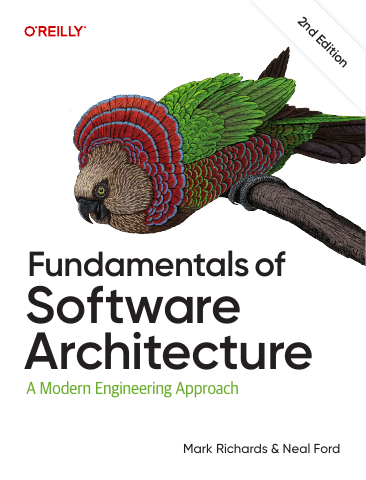

# Fundamentals of Software Architecture, Second Edition

[← Architecture & Scalability](../README.md) · [All categories](../../../README.md#categories)

- **Author(s):** Mark Richards and Neal Ford
- **About:** Architectural styles, characteristics, and design trade-offs.
- **Publisher / official book:** [O’Reilly — 2nd edition](https://www.oreilly.com/library/view/fundamentals-of-software/9781098175504/)
- **Access:** [Google Books search](https://books.google.com/books?q=Fundamentals%20of%20Software%20Architecture)
