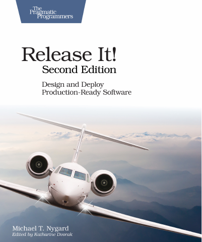

# Release It!: Design and Deploy Production-Ready Software

[← Architecture & Scalability](../README.md) · [All categories](../../../README.md#categories)

- **Author(s):** Michael T. Nygard
- **About:** Production resilience, stability patterns, and operational readiness.
- **Publisher / official book:** [Pragmatic Bookshelf — 2nd edition; buy ebook](https://books.pragprog.com/titles/mnee2/release-it-second-edition/)
- **Access:** [Google Books search](https://books.google.com/books?q=Release%20It%21%3A%20Design%20and%20Deploy%20Production-Ready%20Software)
