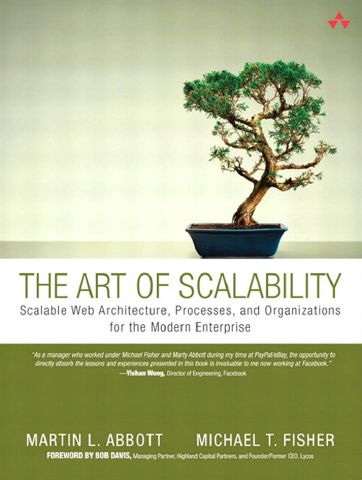

# The Art of Scalability

[← Architecture & Scalability](../README.md) · [All categories](../../../README.md#categories)

- **Author(s):** Martin L. Abbott and Michael T. Fisher
- **About:** Scaling technology platforms, organizations, and delivery processes.
- **Publisher / official book:** [Addison-Wesley / InformIT — original edition (out of print)](https://www.informit.com/store/art-of-scalability-scalable-web-architecture-processes-9780137030422); [buy the 2nd edition](https://www.informit.com/store/art-of-scalability-scalable-web-architecture-processes-9780134032801)
- **Access:** [Google Books search](https://books.google.com/books?q=The%20Art%20of%20Scalability)
