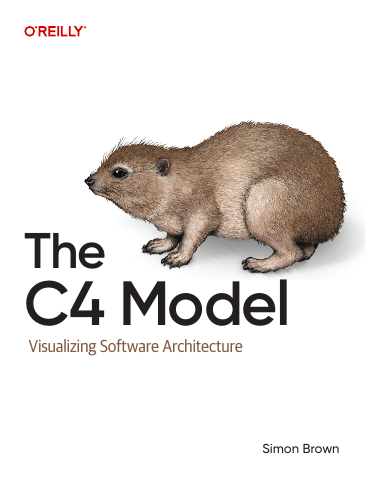

# The C4 Model: Visualizing Software Architecture

[← Architecture & Scalability](../README.md) · [All categories](../../../README.md#categories)

- **Author(s):** Simon Brown
- **About:** A hierarchy of diagrams for communicating software architecture.
- **Publisher / official book:** [O’Reilly — The C4 Model (2026)](https://www.oreilly.com/library/view/the-c4-model/9798341660113/)
- **Access:** [Free official documentation](https://c4model.com/) — PDF redistribution permission not verified
