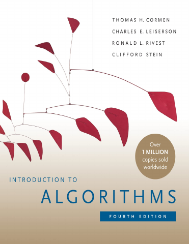

# Introduction to Algorithms, Fourth Edition

[← Computer Science Foundations](../README.md) · [All categories](../../../README.md#categories)

- **Author(s):** Thomas H. Cormen, Charles E. Leiserson, Ronald L. Rivest, and Clifford Stein
- **About:** Algorithms, data structures, and computational complexity.
- **Publisher / official book:** [MIT Press — 4th edition; ebook](https://mitpress.mit.edu/9780262367509/introduction-to-algorithms/)
- **Access:** [Google Books search](https://books.google.com/books?q=Introduction%20to%20Algorithms%2C%20Fourth%20Edition)
