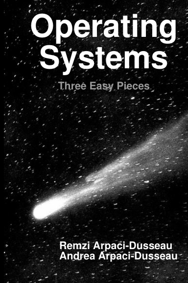

# Operating Systems: Three Easy Pieces

[← Computer Science Foundations](../README.md) · [All categories](../../../README.md#categories)

- **Author(s):** Remzi H. Arpaci-Dusseau and Andrea C. Arpaci-Dusseau
- **About:** Operating systems through virtualization, concurrency, and persistence.
- **Publisher / official book:** [Authors’ official site — free chapters, paid complete PDF, or print](https://pages.cs.wisc.edu/~remzi/OSTEP/)
- **Access:** [Free official reading/download](https://pages.cs.wisc.edu/~remzi/OSTEP/) — permission to re-host not verified
