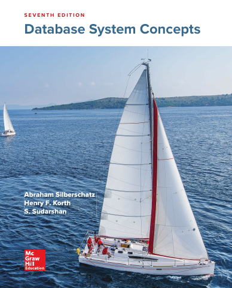

# Database System Concepts, Seventh Edition

[← Databases & Data Systems](../README.md) · [All categories](../../../README.md#categories)

- **Author(s):** Abraham Silberschatz, Henry F. Korth, and S. Sudarshan
- **About:** Relational databases, transactions, storage, and query processing.
- **Publisher / official book:** [McGraw Hill — 7th edition](https://www.mheducation.com/highered/product/database-system-concepts-silberschatz)
- **Access:** [Google Books search](https://books.google.com/books?q=Database%20System%20Concepts%2C%20Seventh%20Edition)
