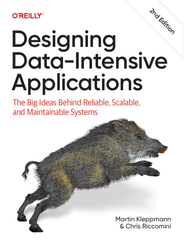

# Designing Data-Intensive Applications, Second Edition

[← Databases & Data Systems](../README.md) · [All categories](../../../README.md#categories)

- **Author(s):** Martin Kleppmann and Chris Riccomini
- **About:** Storage, replication, distributed data, and reliability trade-offs.
- **Publisher / official book:** [O’Reilly — 2nd edition](https://www.oreilly.com/library/view/designing-data-intensive-applications/9781098119058/)
- **Access:** [Google Books search](https://books.google.com/books?q=Designing%20Data-Intensive%20Applications)
