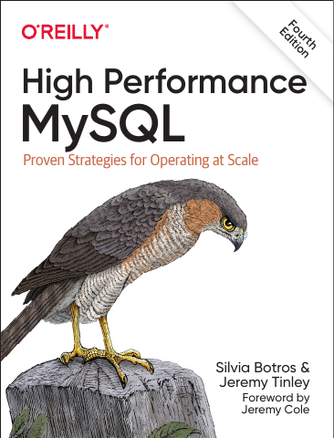

# High Performance MySQL

[← Databases & Data Systems](../README.md) · [All categories](../../../README.md#categories)

- **Author(s):** Silvia Botros and Jeremy Tinley
- **About:** MySQL performance, operations, query optimization, and scaling.
- **Publisher / official book:** [O’Reilly — 4th edition](https://www.oreilly.com/library/view/high-performance-mysql/9781492080503/)
- **Access:** [Google Books search](https://books.google.com/books?q=High%20Performance%20MySQL)
