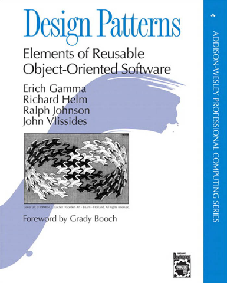

# Design Patterns: Elements of Reusable Object-Oriented Software

[← Design Patterns & DDD](../README.md) · [All categories](../../../README.md#categories)

- **Author(s):** Erich Gamma, Richard Helm, Ralph Johnson, and John Vlissides
- **About:** Foundational object-oriented design patterns (the Gang of Four).
- **Publisher / official book:** [Addison-Wesley / InformIT — buy ebook](https://www.informit.com/store/design-patterns-elements-of-reusable-object-oriented-9780321770462)
- **Access:** [Google Books search](https://books.google.com/books?q=Design%20Patterns%3A%20Elements%20of%20Reusable%20Object-Oriented%20Software)
