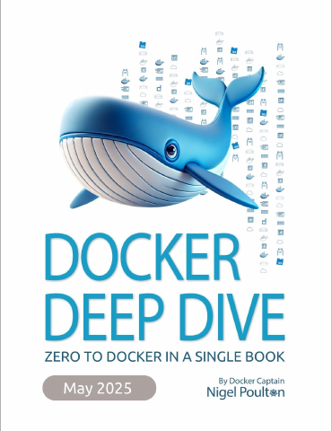
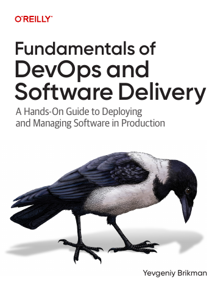
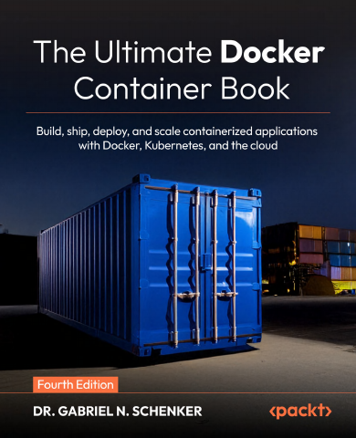

# DevOps, Containers & Operations

[← All categories](../../README.md#categories)

5 books. Open a title for its publisher links and access details.

| Cover | Book | Authors |
|---|---|---|
|  | [Docker Deep Dive, 2025 Edition](docker-deep-dive/README.md) | Nigel Poulton |
|  | [Fundamentals of DevOps and Software Delivery](fundamentals-of-devops-and-software-delivery/README.md) | Yevgeniy Brikman |
|  | [Observability Engineering, Second Edition](observability-engineering/README.md) | Charity Majors, Liz Fong-Jones, and George Miranda, with Austin Parker |
|  | [Pro Git](pro-git/README.md) | Scott Chacon and Ben Straub |
|  | [The Ultimate Docker Container Book, Fourth Edition](the-ultimate-docker-container-book/README.md) | Dr. Gabriel N. Schenker |
