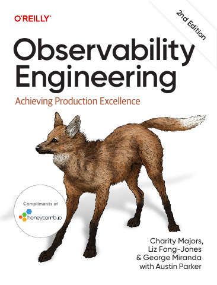

# Observability Engineering, Second Edition

[← DevOps, Containers & Operations](../README.md) · [All categories](../../../README.md#categories)

- **Author(s):** Charity Majors, Liz Fong-Jones, and George Miranda, with Austin Parker
- **About:** Instrumentation, debugging, and understanding production systems.
- **Publisher / official book:** [O’Reilly — 2nd edition](https://www.oreilly.com/library/view/observability-engineering-2nd/9781098179915/)
- **Access:** [Google Books search](https://books.google.com/books?q=Observability%20Engineering)
