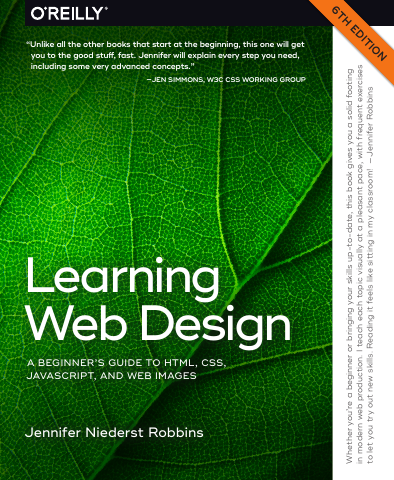

# Learning Web Design: A Beginner’s Guide to HTML, CSS, JavaScript, and Web Images, Sixth Edition

[← Frontend & Web Development](../README.md) · [All categories](../../../README.md#categories)

- **Author(s):** Jennifer Niederst Robbins
- **About:** Fundamentals of creating web pages and web experiences.
- **Publisher / official book:** [O’Reilly — 6th edition](https://www.oreilly.com/library/view/learning-web-design/9781098137670/)
- **Access:** [Google Books search](https://books.google.com/books?q=Learning%20Web%20Design%3A%20A%20Beginner%E2%80%99s%20Guide%20to%20HTML%2C%20CSS%2C%20JavaScript%2C%20and%20Web%20Graphics)
