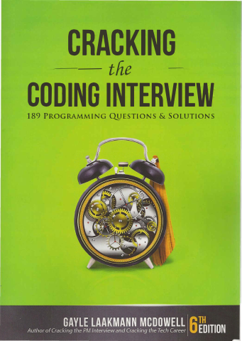

# Cracking the Coding Interview

[← Interviews & System Design](../README.md) · [All categories](../../../README.md#categories)

- **Author(s):** Gayle Laakmann McDowell
- **About:** Algorithmic interview preparation and problem-solving strategies.
- **Publisher / official book:** [Official book site — 6th edition](https://www.crackingthecodinginterview.com/)
- **Access:** [Google Books search](https://books.google.com/books?q=Cracking%20the%20Coding%20Interview)
