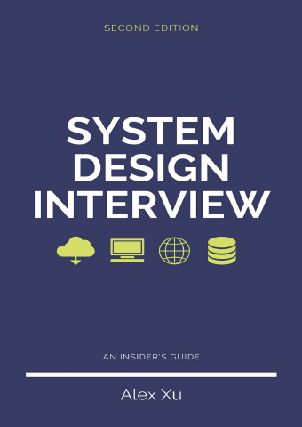

# System Design Interview: An Insider’s Guide, Volume 1

[← Interviews & System Design](../README.md) · [All categories](../../../README.md#categories)

- **Author(s):** Alex Xu
- **About:** System design interview frameworks and common service designs.
- **Publisher / official book:** [Shroff / ByteByteGo — Volume 1, regional print edition](https://www.shroffpublishers.com/books/9789355427199/)
- **Access:** [Google Books search](https://books.google.com/books?q=System%20Design%20Interview%3A%20An%20Insider%E2%80%99s%20Guide)
