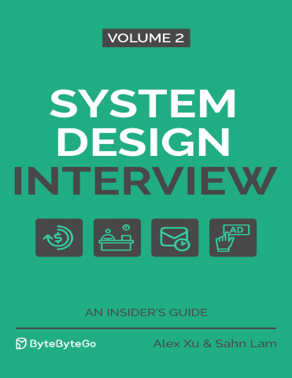

# System Design Interview: An Insider’s Guide, Volume 2

[← Interviews & System Design](../README.md) · [All categories](../../../README.md#categories)

- **Author(s):** Alex Xu and Sahn Lam
- **About:** System design case studies covering services such as proximity search, distributed queues, payment systems, and stock exchanges.
- **Publisher / official book:** [Shroff / ByteByteGo — Volume 2, regional print edition](https://www.shroffpublishers.com/books/9789355428868/)
- **Access:** [Google Books search](https://books.google.com/books?q=System%20Design%20Interview%20Volume%202%20Alex%20Xu%20Sahn%20Lam)
