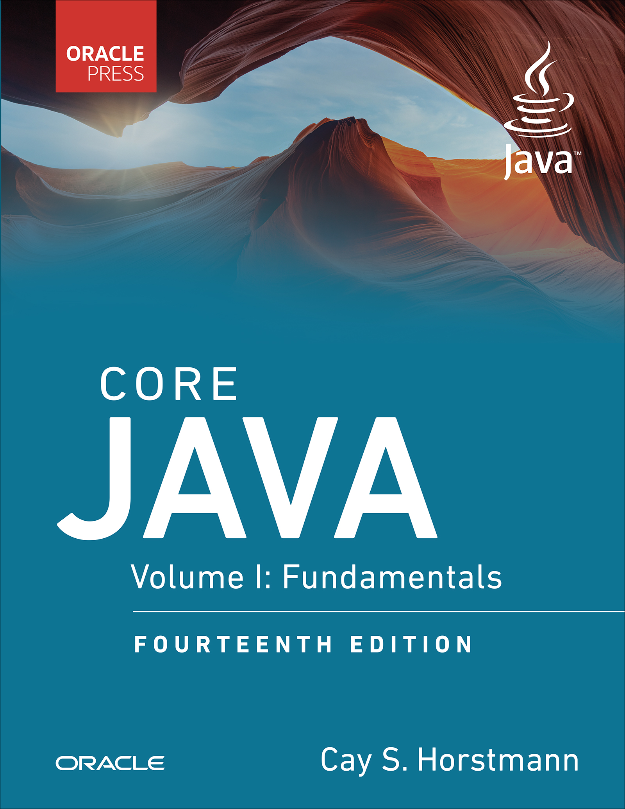

# Core Java, Volume I: Fundamentals, 14th Edition

[← Java & Spring](../README.md) · [All categories](../../../README.md#categories)

- **Author(s):** Cay S. Horstmann
- **About:** Java language fundamentals and core programming techniques.
- **Publisher / official book:** [Oracle Press / InformIT — buy print or ebook](https://www.informit.com/store/core-java-vol.-i-fundamentals-9780135558577)
- **Access:** [Google Books search](https://books.google.com/books?q=Core%20Java%2C%20Volume%20I%3A%20Fundamentals%2C%2014th%20Edition)
