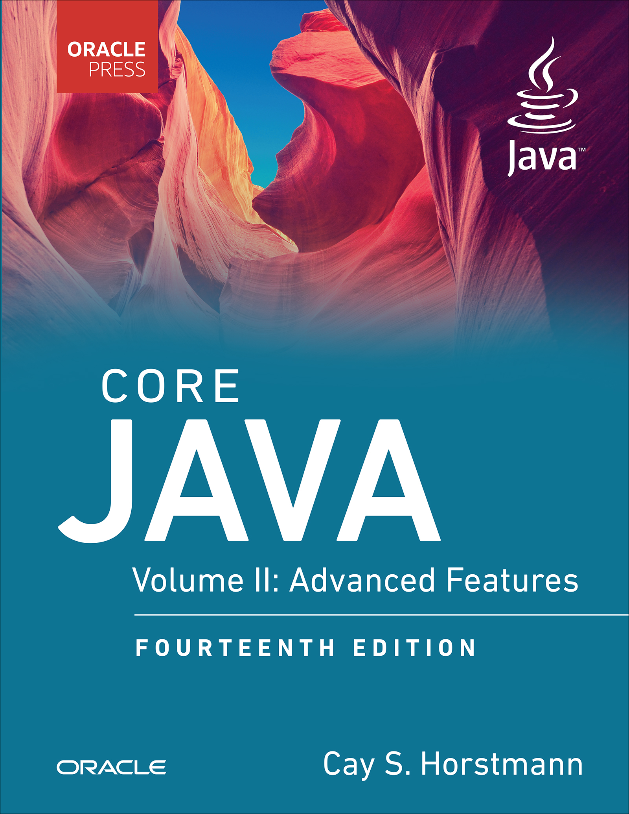

# Core Java, Volume II: Advanced Features, 14th Edition

[← Java & Spring](../README.md) · [All categories](../../../README.md#categories)

- **Author(s):** Cay S. Horstmann
- **About:** Advanced Java libraries and platform capabilities; confirm file edition.
- **Publisher / official book:** [Oracle Press / InformIT — 14th edition; buy ebook](https://www.informit.com/store/core-java-volume-ii-advanced-features-9780135558706)
- **Access:** [Google Books search](https://books.google.com/books?q=Core%20Java%2C%20Volume%20II%3A%20Advanced%20Features)
