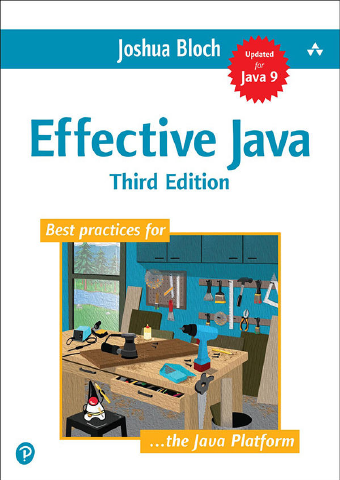

# Effective Java

[← Java & Spring](../README.md) · [All categories](../../../README.md#categories)

- **Author(s):** Joshua Bloch
- **About:** Effective Java API design and robust coding practices.
- **Publisher / official book:** [Addison-Wesley / InformIT — 3rd edition; buy ebook](https://www.informit.com/store/effective-java-9780134686059)
- **Access:** [Google Books search](https://books.google.com/books?q=Effective%20Java)
