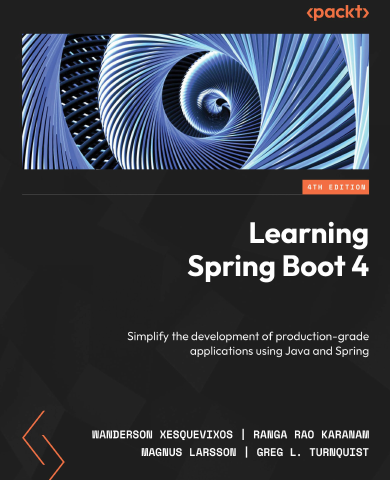

# Learning Spring Boot 4

[← Java & Spring](../README.md) · [All categories](../../../README.md#categories)

- **Author(s):** Wanderson Xesquevixos, Ranga Rao Karanam, Magnus Larsson, and Greg L. Turnquist
- **About:** Spring Boot 4 application development; the official title is the fourth edition of the Learning Spring Boot series.
- **Publisher / official book:** [Packt — 4th edition; buy ebook](https://www.packtpub.com/en-us/product/learning-spring-boot-4-9781807427108)
- **Access:** [Google Books search](https://books.google.com/books?q=Learning%20Spring%20Boot%204)
