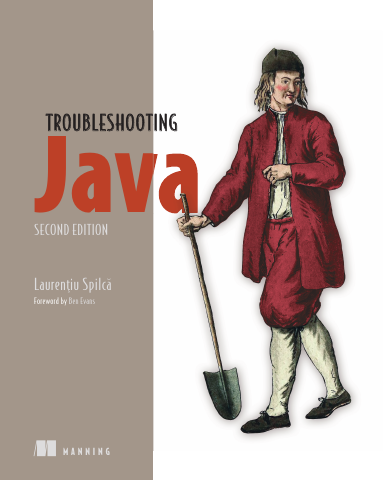

# Troubleshooting Java, Second Edition

[← Java & Spring](../README.md) · [All categories](../../../README.md#categories)

- **Author(s):** Laurentiu Spilca
- **About:** Diagnosing and solving Java application issues.
- **Publisher / official book:** [Manning — buy print or ebook](https://www.manning.com/books/troubleshooting-java-second-edition)
- **Access:** [Google Books search](https://books.google.com/books?q=Troubleshooting%20Java%2C%20Second%20Edition)
