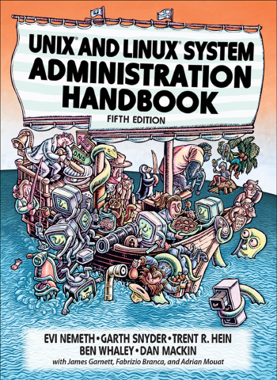

# UNIX and Linux System Administration Handbook

[← Linux, Networking & Infrastructure](../README.md) · [All categories](../../../README.md#categories)

- **Author(s):** Evi Nemeth, Garth Snyder, Trent R. Hein, Ben Whaley, and Dan Mackin
- **About:** Practical UNIX/Linux administration and infrastructure operations.
- **Publisher / official book:** [Addison-Wesley / InformIT — 5th edition; buy print or ebook](https://www.informit.com/store/unix-and-linux-system-administration-handbook-9780134277554)
- **Access:** [Google Books search](https://books.google.com/books?q=UNIX%20and%20Linux%20System%20Administration%20Handbook)
