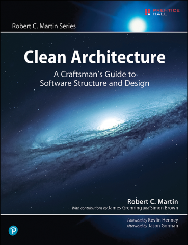
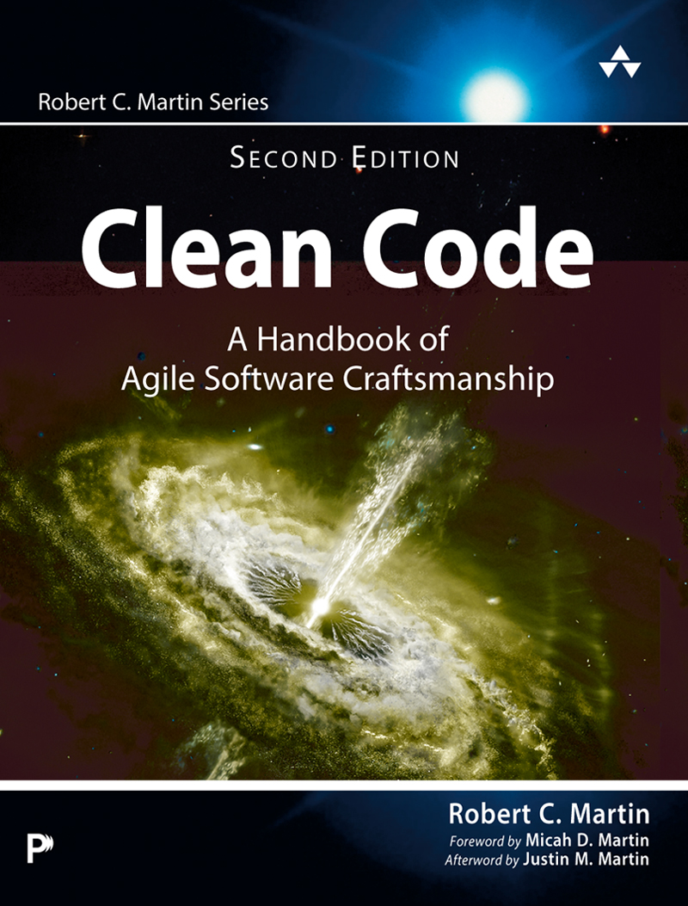
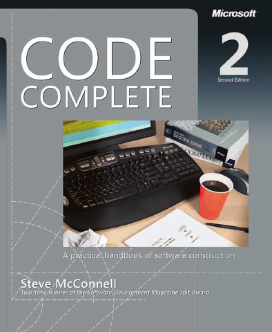
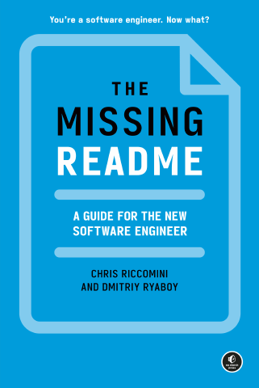
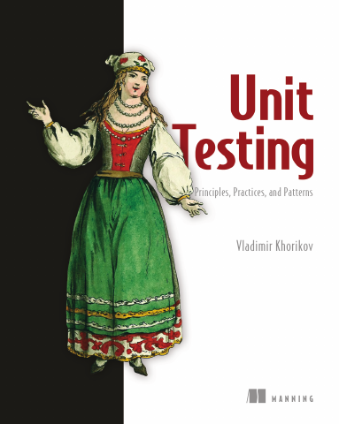

# Software Craftsmanship

[← All categories](../../README.md#categories)

5 books. Open a title for its publisher links and access details.

| Cover | Book | Authors |
|---|---|---|
|  | [Clean Architecture: A Craftsman’s Guide to Software Structure and Design](clean-architecture/README.md) | Robert C. Martin |
|  | [Clean Code, Second Edition](clean-code/README.md) | Robert C. Martin |
|  | [Code Complete, Second Edition](code-complete/README.md) | Steve McConnell |
|  | [The Missing README: A Guide for the New Software Engineer](the-missing-readme/README.md) | Chris Riccomini and Dmitriy Ryaboy |
|  | [Unit Testing: Principles, Practices, and Patterns](unit-testing/README.md) | Vladimir Khorikov |
